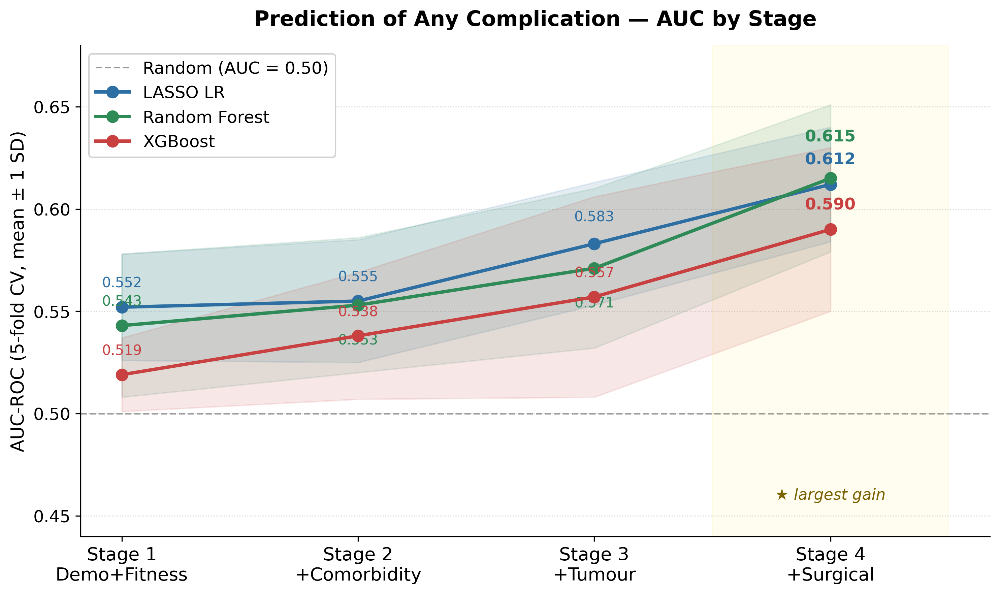
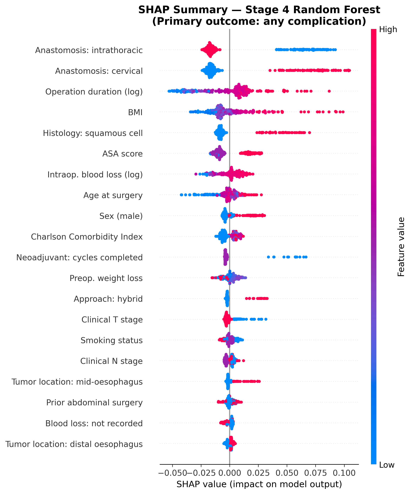
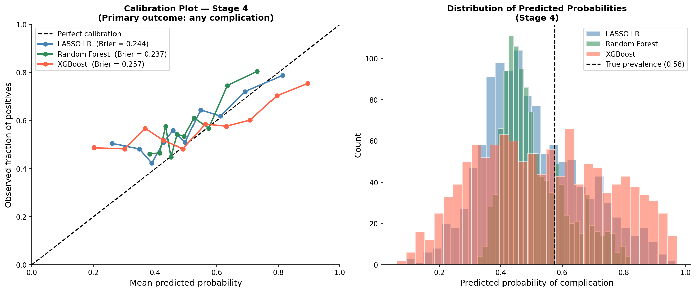
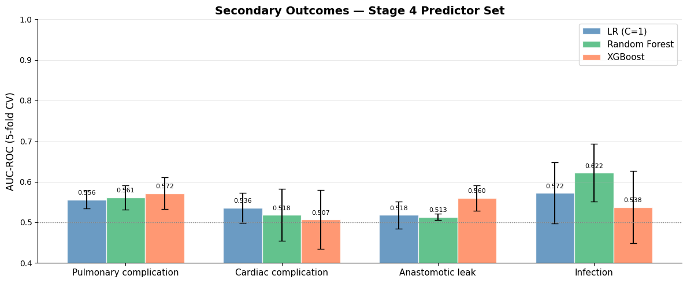
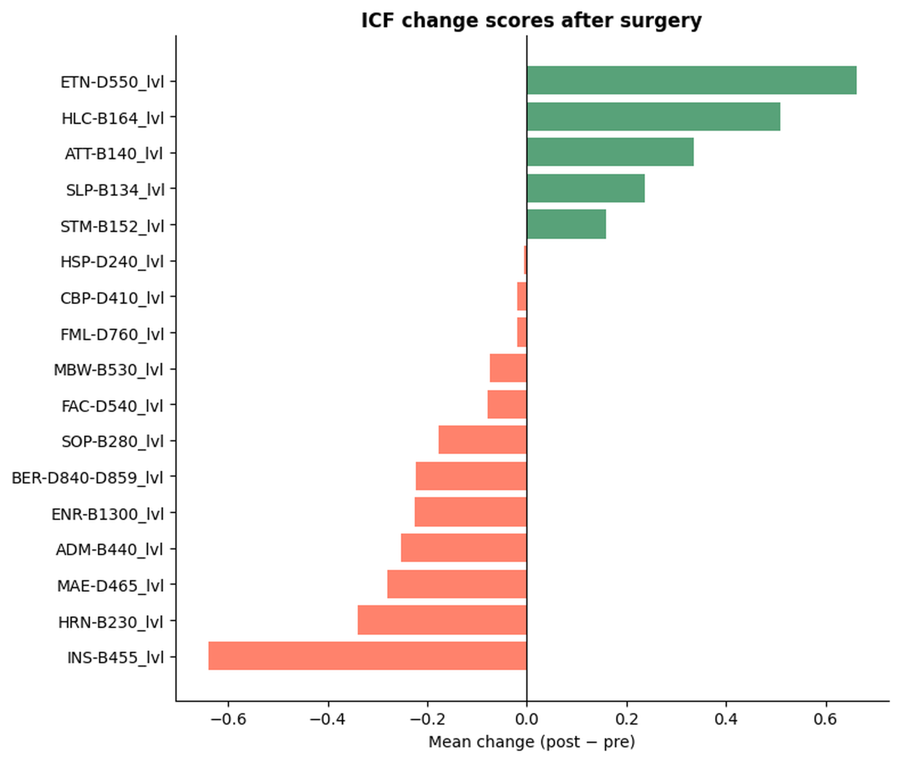

# Predicting Complications After Esophagectomy

**More than half of the patients who have their esophagus removed for cancer develop a complication after surgery.
How early, and from which information, can we see it coming?**

MSc Applied Data Science thesis, Utrecht University, in collaboration with the Departments of Surgery and
Rehabilitation Medicine at Amsterdam UMC.
[Full thesis (PDF)](docs/thesis_report.pdf) · [Poster](docs/poster_presentation.pdf)

**Stack:** Python · pandas · scikit-learn · XGBoost · SHAP · SciPy

---

## The question

Esophagectomy is one of the most demanding operations in surgical oncology. In the Amsterdam UMC cohort, 57.6% of
patients had at least one complication within 30 days: pulmonary problems, cardiac events, anastomotic leaks, infections.
If the risk could be estimated before the operation, surgeons and physiotherapists could counsel patients better and
target prehabilitation where it matters most.

Existing risk models only reach moderate accuracy, so instead of asking *"can we predict complications?"* I asked a
more useful question: **at which point in the patient pathway does the risk become predictable, and what adds the most?**

## The data

The Amsterdam UMC cohort of the Dutch Upper GI Cancer Audit (DUCA), a nationwide prospective registry:
**1,181 patients operated on between 2016 and 2025**, mostly male (78%), median age 67, 83% adenocarcinoma,
77% minimally invasive surgery.

As a second source, functioning scores in 17 ICF domains (such as exercise tolerance, respiration and eating) were
extracted from clinical notes by an NLP classifier and linked to the surgical cohort. Each domain is scored 0 to 4,
with higher scores meaning better functioning.

All analysis ran inside a secure research environment (MyDRE). **No patient data is included in this repository.**

## Approach: adding information the way a clinician gets it

Rather than one model with every variable, predictors were added in four cumulative stages that follow the clinical pathway:

| Stage | What is added | Variables (cumulative) |
|---|---|---|
| 1 | Demographics and fitness: age, sex, BMI, ASA score | 4 |
| 2 | Comorbidity and lifestyle: Charlson index, arrhythmia, smoking, weight loss, ... | 12 |
| 3 | Tumour and neoadjuvant treatment: T/N stage, histology, location, neoadjuvant treatment | 24 |
| 4 | Surgical factors: approach, anastomosis, operation duration, blood loss, ... | 39 |

At every stage I compared three models of increasing flexibility, **LASSO logistic regression, Random Forest and
XGBoost**, evaluated with 5-fold stratified cross-validation. Imputation and scaling were fitted inside each training
fold, so no information leaked from the validation patients.

## What I found

### 1. Risk only becomes predictable once the surgical details are known

Demographics alone are close to a coin flip (AUC 0.52 to 0.55). Comorbidities and tumour characteristics add a little,
but the **largest single gain comes at Stage 4, when the surgical factors are added** (+0.03 to +0.04 AUC).
The best model, a Random Forest, reaches **AUC 0.615**, with LASSO almost identical at 0.612.

The three algorithms end up within 0.03 of each other. That is a finding in itself: the ceiling comes from **what the
data contains, not from the choice of algorithm**. Much of what causes a complication seems to happen during and after
the operation, which no preoperative variable can capture.

### 2. What drives the predictions

SHAP values on the Stage 4 Random Forest rank anastomosis location, operation duration, BMI, histology and ASA score as
the strongest predictors. Each dot is a patient; dots to the right of zero push the predicted complication risk up.

- **Cervical anastomosis** pushes predicted risk up, and an **intrathoracic anastomosis** pushes it down, in line with the
  higher leak rates usually reported for cervical anastomoses.
- **Longer operations, higher BMI, higher ASA scores and squamous cell histology** all increase predicted risk, consistent
  with surgical complexity and patient frailty.

The top predictor needs care, though. In this cohort the anastomosis location is almost fully determined by the surgical
approach: minimally invasive surgery (77% of cases) uses an intrathoracic anastomosis, while open and hybrid approaches
typically use a cervical one. The model is therefore largely picking up **surgical approach and case mix, not a causal
effect**, so it does not mean that changing the anastomosis site would change a patient's risk.

### 3. The probabilities need calibration before they reach a patient

A model can rank patients reasonably well and still give misleading probabilities. Random Forest had the best Brier score
(0.237), only slightly better than predicting the average risk for everyone (0.244). XGBoost spread its predictions so widely
that it scored *worse* than that baseline (0.257). All three models stay close to the population average, so post-hoc
calibration would be needed before any probability is communicated as a personal risk.

### 4. Specific complications are much harder to predict

With the same Stage 4 predictors, unplanned ICU admission was the most predictable secondary outcome (AUC 0.637).
Among patients who had a complication, the specific type (pulmonary, cardiac, anastomotic leak, infection) stayed close
to chance, as did severe complications (Clavien-Dindo III or higher) and return to the operating room.

### 5. The data-driven model outperformed qualitative clinical judgement

Before surgery, physiotherapists classify patients as high or low risk. On the 517 patients with both an assessment and a
known outcome, that classification reached **AUC 0.536** and, at the "high risk" threshold, missed 56% of all complications.
The Stage 4 model on the same patients reached **AUC 0.629**. This is not a critique of physiotherapists: it shows that a
qualitative judgement is hard to use for prediction, and that structured, quantified functional measures would serve them better.

### 6. How patients' functioning changes after surgery

ICF scores run from 0 to 4, where **higher means better functioning**, so a positive change is an improvement.
Comparing the last note before surgery with the most recent note within 180 days after, most physical domains worsened,
with exercise tolerance declining the most (Δ = −0.64). Eating improved the most (Δ = +0.66), consistent with relief of
the tumour blocking the esophagus. Eleven of 17 domains changed significantly (Wilcoxon signed-rank test).

These results are descriptive: preoperative notes exist only for patients referred to physiotherapy (45% of the cohort),
and that group was older, with higher ASA scores and fewer complications, than patients without notes. Adding preoperative
ICF scores did not improve the model, although exercise tolerance was the strongest ICF predictor that LASSO kept.

## What it means

Routine registry data can predict complication risk after esophagectomy only moderately (AUC ≈ 0.61). The surgical plan
adds the most, and the remaining uncertainty likely sits in intraoperative events and early recovery that preoperative
data cannot see. The most promising next step is collecting **structured functional measures prospectively** for all
patients (for example a six-minute walk test or quantified ICF scores), which would remove the selection bias and provide
enough data to test their real value.

## Checks on the results

- **Leakage-safe validation:** imputation and scaling fitted within each cross-validation fold; only information available before or during surgery is used as input.
- **Hyperparameter sensitivity:** across 12 Random Forest configurations the AUC varied by only 0.006 ([figure](figures/fig_hyperparam_sensitivity.png)), so the result is not a tuning artefact.
- **Multicollinearity:** no pair of continuous predictors correlated above |r| = 0.40.
- **Spirometry:** a Stage 5 sensitivity analysis added lung function (FEV1% predicted) for the 532 patients where it was available.
- **More figures:** [ROC curves at Stage 4](figures/fig_roc_stage4.png) · [global SHAP ranking](figures/shap_bar.png) · [ICF predictors](figures/predicting_features_icf.png)

## Repository guide

| Notebook | What it does |
|---|---|
| [`01_preprocessing`](analysis/01_preprocessing.ipynb) | Builds the DUCA cohort (N = 1,181), recodes registry sentinel values to missing, derives the outcomes (any complication, Clavien-Dindo grade, major complication) |
| [`02_descriptive_statistics`](analysis/02_descriptive_statistics.ipynb) | Cohort description and outcome prevalence |
| [`03_staged_prediction_model`](analysis/03_staged_prediction_model.ipynb) | The four-stage models, cross-validation, calibration, hyperparameter sensitivity and SHAP |
| [`04_icf_perioperative_analysis`](analysis/04_icf_perioperative_analysis.ipynb) | Pre- vs post-operative functioning across 17 ICF domains (N = 533) |
| [`05_icf_prediction_value`](analysis/05_icf_prediction_value.ipynb) | Physiotherapist classification vs the model, selection bias, added value of ICF scores |

`supplementary/lung_analysis/` contains exploratory side work on the Dutch Lung Surgery Audit (DLSA, N ≈ 1,200) using
the same methodology. It is not part of the thesis and is still in progress.

The notebooks document every analysis step and modelling choice, but they cannot be run end to end without access to the
DUCA registry through the appropriate governance route. Outputs were cleared before publishing. Developed with Python 3.10
(pandas 2.1, scikit-learn 1.3, xgboost 2.0, shap 0.44); see `requirements.txt`.

## Author and supervision

**Author:** Charalampos Zisis, MSc Applied Data Science, Utrecht University

**University supervisors:**
- G. Barkema, Department of Computer Science, Utrecht University
- M. Brinkhuis, Department of Computer Science, Utrecht University

**External supervisor:**
- E. Geleijn, Amsterdam UMC *(clinical lead; project and risk assessment design)*

**Clinical collaborators:**
- Dr. Marike van der Leeden, Amsterdam UMC *(analysis and clinical decisions)*
- Dr. M. van Dorp, MD PhD, Cardiothoracic Surgery, Amsterdam UMC
- H.C.G. Overtoom, MD, Upper GI Surgery, Amsterdam UMC
- Prof. M.I. van Berge Henegouwen, MD PhD, Upper GI Surgery, University of Amsterdam *(overall responsible for the DUCA database)*

## Acknowledgements

With thanks to the Department of Surgery and the Department of Rehabilitation Medicine at Amsterdam UMC, to the DUCA
registry, and to the A-PROOF ICF classifier developed by CLTL at VU Amsterdam.
